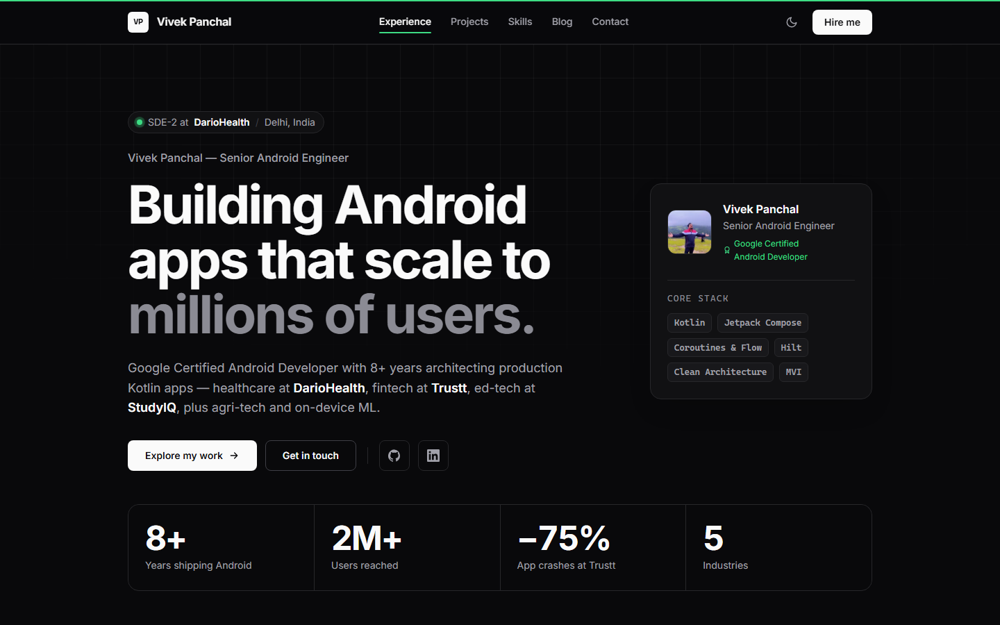
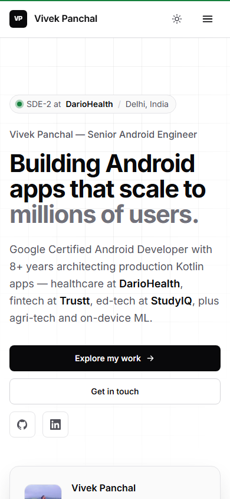

<div align="center">

# vivekpanchal.dev

**Portfolio of Vivek Panchal: Senior Android Engineer, Google Certified Android Developer, 8+ years shipping Kotlin apps.**

[](https://github.com/vivekpanchal/vivekpanchal.github.io/actions/workflows/deploy.yml)
[](https://astro.build)


[**Live site →**](https://vivekpanchal.dev) · [Blog](https://vivekpanchal.dev/blog) · [Resume](https://drive.google.com/file/d/1LRgtobUcutRahsjbtUsRk1HcSNrNTEJn/view?usp=sharing) · [LinkedIn](https://www.linkedin.com/in/vivekpanchal-developer/)

<br />


&nbsp;


</div>

## Highlights

- **Static by default.** Every section is plain `.astro` and ships no JavaScript. The few interactive parts (theme toggle, mobile drawer, scrollspy) are small scripts.
- **Zero-JS project filter.** Native radio buttons plus `:has()` selectors generated at build time.
- **Live GitHub stats.** Star and fork counts are fetched once at build time, with static fallbacks if the API is unavailable.
- **Modern CSS motion, all reduced-motion aware:**
  - `sibling-index()` stagger on the hero
  - scroll-driven reveals and a timeline progress rail
  - `:target-current` scrollspy
  - a `scroll-state()` sticky-header shadow
  - `linear()` spring easing
- **Smooth navigation.** Astro `ClientRouter` view transitions; blog titles morph between the list and the post.
- **Accessible.** WCAG AA contrast in both themes, a skip link, 44px touch targets, `aria-current` kept in sync, and a swipeable popover drawer with `inert` backgrounds.
- **Theme follows the OS.** A two-state override is stored in `<meta name="color-scheme">`, so the theme works without JavaScript.
- **SEO.** Person JSON-LD with credentials, Open Graph and Twitter cards, sitemap and RSS.

## Lighthouse

Measured on the production build with Lighthouse 12 (mobile uses simulated slow 4G).

| Page | Performance | Accessibility | Best Practices | SEO |
|---|:-:|:-:|:-:|:-:|
| Home (mobile / desktop) | 98–99 / 100 | 100 | 100 | 100 |
| Blog index (mobile / desktop) | 100 / 100 | 100 | 100 | 100 |
| Blog post (mobile / desktop) | 99 / 99 | 100 | 100 | 100 |

## Tech stack

| | |
|---|---|
| Framework | [Astro 7](https://astro.build), static output |
| Styling | Hand-written CSS with design tokens (no CSS framework) |
| Type | Inter Variable (self-hosted via Fontsource) |
| Content | Markdown blog via Astro content collections (`glob()` loader) |
| Images | `astro:assets`: remote avatar optimised to WebP at build |
| Hosting | GitHub Pages, deployed by GitHub Actions |

## Project structure

```text
src/
├── components/
│   ├── sections/        # Greeting (hero), Experience, Projects, Skills, ...
│   ├── Header.astro     # nav, scrollspy, mobile drawer
│   ├── SEO.astro        # meta tags + JSON-LD
│   └── ThemeToggle.astro
├── content/blog/        # blog posts (Markdown)
├── layouts/Layout.astro # shell, ClientRouter, theme bootstrap
├── pages/               # /, /blog, /blog/[slug], /rss.xml, 404
└── styles/global.css    # design tokens + base styles
public/                  # favicons, CNAME, blog cover images
```

## Run locally

Requires **Node 22.22+**.

```bash
npm ci
npm run dev       # http://localhost:4321
npm run build     # outputs to dist/
npm run preview   # serve the production build
```

## Editing content

| To change | Edit |
|---|---|
| Work history, impact numbers | `experiences` in `src/components/sections/Experience.astro` |
| Hero metrics and stack | `metrics` / `stack` in `src/components/sections/Greeting.astro` |
| Open-source projects and filters | `projects` / `filters` in `src/components/sections/Projects.astro` |
| Skills, certifications | `Skills.astro`, `Certifications.astro` |
| Blog posts | Add a Markdown file to `src/content/blog/` (frontmatter schema in `src/content.config.ts`) |
| Colours, type, spacing | Tokens at the top of `src/styles/global.css` |

## Deployment

Every push to `main` builds and deploys to GitHub Pages through [`.github/workflows/deploy.yml`](.github/workflows/deploy.yml). Pull requests into `main` run the same build as a check, without deploying.

## Contact

Open to senior Android roles and collaborations. Email: [vivekpanchal64@gmail.com](mailto:vivekpanchal64@gmail.com).
